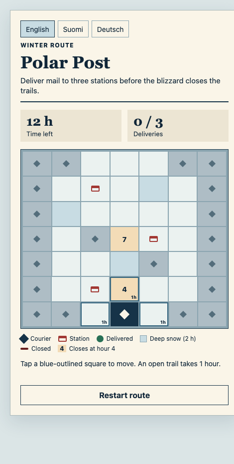
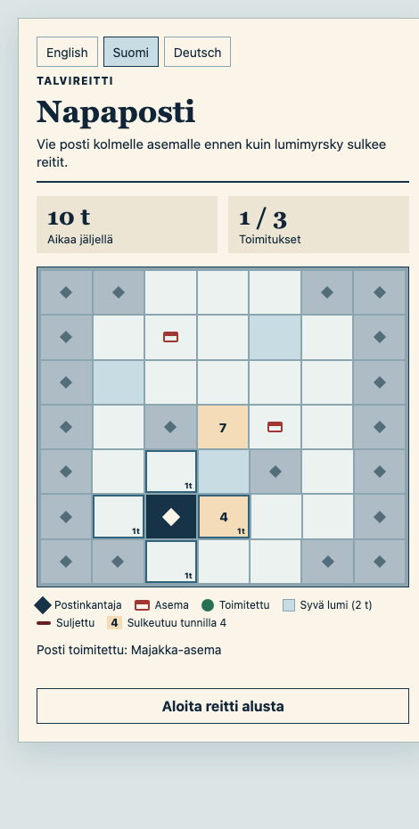

# Polar Post

Deliver mail to three polar stations before a blizzard closes the passes. Polar Post is a single-player, turn-based route puzzle built with GeaStack for the web and Sailfish OS. The game is playable in English, Finnish and German.

## How to play

Tap an outlined neighbouring square to move. Crossing an open trail costs one hour. Deep snow costs two. The number on a pass is its closing hour, so you must arrive **before** that hour. Visit all three stations in any order within 12 hours. Delivery happens automatically when you enter a station.

## Known Sailfish OS rendering issues

**Rendering issues persist on physical Sailfish OS hardware.** The ARM64 game launches, but device testing still showed visual errors after the app-level workarounds. The native build uses the GeaStack Core fork at `77b9806`.

- **Missing symbols.** Some map icons appeared as question marks. Polar Post now draws the markers with CSS shapes, which were visible in subsequent device photos. GeaStack Core has a related report about Turkish character coverage in its runtime font renderer. [Core issue #78](https://github.com/geastack/core/issues/78)
- **Overlapping layout.** An explicit board height improved the spacing around the legend and restart button. A later device photo still showed the title and mission text running together. Version 0.1.4 puts the header on separate rows and passed browser checks in all three languages. The remaining device symptoms need further diagnosis.

The cause of the layout difference remains open. Both Core's layout calculations and the viewport supplied by the Sailfish target are relevant to that investigation.

## Screenshots

The web build of version 0.1.4, at the start of a route in English and after the first delivery in Finnish.

 

## Run the web game

From the project root, using Node.js 22.12 or later in the 22.x series and npm:

```sh
npm ci
npm run dev
```

Open the local address printed by Vite. To check the TypeScript source and build the static site in `dist/web`:

```sh
npm run check
npm run build -- --outDir dist/web
```

## Build for Sailfish OS

The native ARM64 build uses the [Linux target fork](https://github.com/mehmetfiskindal/linux) and [Core fork](https://github.com/mehmetfiskindal/core). The project ignores `vendor/` in Git. On a fresh checkout, run `npm ci` in the project root, then set up the revisions used for 0.1.4:

```sh
mkdir -p vendor
git clone https://github.com/mehmetfiskindal/linux.git vendor/linux
git -C vendor/linux checkout --detach d462a37d6dae627d538b54dc12d58de363bd2c62
git clone https://github.com/mehmetfiskindal/core.git vendor/core
git -C vendor/core checkout --detach 77b980616b5be74b0e5cec70bda16864b9fce76a
npm --prefix vendor/linux install --no-save --package-lock=false @geastack/core@0.1.55 @geastack/compiler@^1.0.49 @geastack/geatsc-plugin-gea@0.1.28
```

The Linux build tools check that their installed Core package matches the Core checkout. To generate the native sources and RPM project on the host:

```sh
npm run sailfish:prepare -- --arch aarch64
```

With `sfdk` on your PATH and the Sailfish OS 5.1.0.11 aarch64 build target installed, run:

```sh
npm run sailfish:build -- --arch aarch64
```

The SDK build writes packages under `vendor/linux/targets/sailfish-os/build/polar-post-aarch64/project/RPMS/`. The 0.1.4 device package was built from the prepared project using `rpmbuild` in a Sailfish OS 5.1.0.11 aarch64 Docker build environment.
